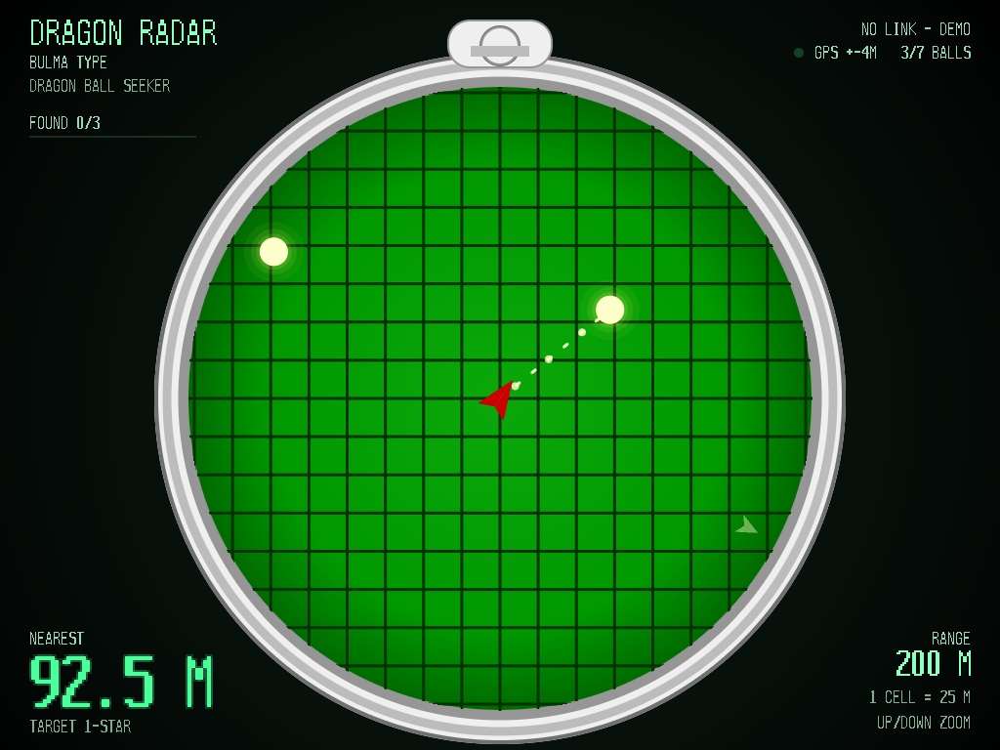
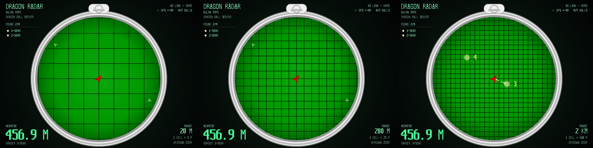
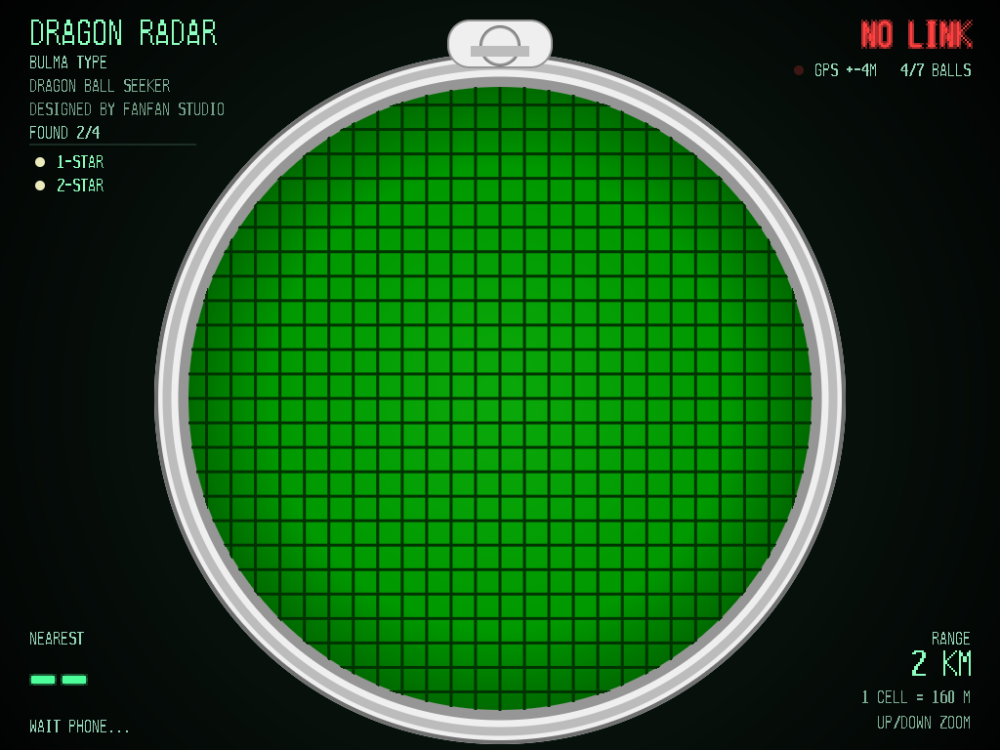

# 龙珠雷达 Dragon Radar

> 用一台TrimUI Brick Pro掌机 + 一部手机，在现实世界找龙珠。
> 手机负责 GPS 定位与地图选点，掌机负责那台动画里一模一样的怀表雷达：绿屏、网格、滴滴声，走到 20 米内还会长鸣锁定。

**A real-world Dragon Radar**: an Android phone supplies GPS + map-picked "dragon ball" positions over Wi-Fi, and a handheld console renders an anime-accurate pocket-watch radar with proximity beeps, range zoom, and lock-on detection.



**▶ 实机演示视频**（67 秒：地图选点 → 掌机缩放 → 户外找珠 → `FOUND >>DRAGON<<`）：[docs/demo.mp4](docs/demo.mp4)

---

## 特性

- **怀表造型雷达**：纯软件光栅化（无 GPU），1024×768 全屏，抗锯齿圆/线/三角 + 8×16 点阵字体
- **7 档量程**：20 M / 50 M / 100 M / 200 M / 500 M / 1 KM / 2 KM，网格随量程自动变密
- **距离感应滴滴声**：方波 1080 Hz，间隔 `clamp(距离 × 8, 90, 1200) ms`，越近越急
- **20 米锁定**：进入 20 m 后同音色**连续长鸣 5 秒**（不变频），光点消失并弹出 `FOUND n-STAR`
- **龙珠闪烁与滴滴同步**：每次"滴"响的瞬间光点最亮，随后快速衰减到熄灭
- **越界指示**：龙珠超出量程时在表盘边缘显示三角形指示方向
- **手机端真实地图选点**：WebView + Leaflet + 高德瓦片，点地图放龙珠，实时显示距离
- **断连保护**：手机断开后掌机保留表盘、隐藏雷达数据、静音，右上角红色 `NO LINK`
- **零配置组网**：UDP 广播自动发现手机 IP，热点 / 同路由器 Wi-Fi 都可

| 量程 20 M / 200 M / 2 KM | 断连状态 |
|---|---|
|  |  |

## 系统结构

```
[Android 手机]                                [掌机 TrimUI Brick Pro]
DragonRadar App                               dragonradar (aarch64, fbdev 直写)
 ├ GPS 采集 (WGS84 → GCJ-02)                  ├ 怀表雷达软件光栅化 1024×768
 ├ UDP :9999  应答掌机发现                     ├ evdev 读按键 / 摇杆
 ├ TCP :9000  服务端, 300 ms/帧 下发           ├ SDL2 仅作音频输出(方波)
 └ WebView + Leaflet 地图选点                  └ 距离判定 → 滴滴 / 5 s 长鸣
        │  下行 {"la":..,"lo":..,"balls":[[la,lo,id]..]}       ▲
        │  下行 {"cmd":"clear"}                                 │ TCP 客户端
        ▼  上行 {"st":1,"found":[id..]}                         │
   掌机自动重连 + 8 s 数据看门狗 ◀──────────────────────────────┘
```

- **坐标系全链路统一 GCJ-02**（高德底图基准），掌机只算两点平面差值，距离准确。
- **找到状态由掌机本地维护**，手机只下发配置与清空指令，断连也不乱。
- **断连自愈**：手机端服务自愈式重建（TCP/UDP/GPS 组件），掌机端 8 s 收不到数据即强制重连。

## 协议

TCP 9000，换行分隔 JSON。

手机 → 掌机（300 ms/帧）：

```json
{"la":39.908700,"lo":116.397500,"acc":8.0,"hdg":90.0,"balls":[[39.9095,116.3985,1],[39.9078,116.3960,2]]}
{"cmd":"clear"}
```

掌机 → 手机（500 ms）：

```json
{"st":1,"found":[1,3]}
```

UDP 发现（端口 9999）：

```
掌机广播  DRAGONRADAR?          (255.255.255.255 + 本网段定向广播, 每 1.2 s)
手机应答  DRAGONRADAR:<自身IP>
```

手机 IP 解析优先级：`phone_ip.txt` 手动指定 > UDP 发现应答 > 默认网关 > 兜底地址。

## 目录结构

```
device/       掌机端 C 源码（单文件 main.c，~1300 行；keyinject.c 为按键注入自测工具）
android/      手机端 Android 工程（Kotlin + WebView 地图前端）
prototype/    早期 HTML 可交互原型（浏览器直接打开，视觉基准）
tools/        交叉编译 / 部署脚本
docs/         截图
```

## 掌机端

### 编译

需要 [zig](https://ziglang.org/)（提供 aarch64 工具链）和 SDL2 的开发头/库（只需链接 `libSDL2`，程序自身直写 framebuffer）。

```bash
export SDL_ROOT=/path/to/SDL2     # 需含 include/SDL2/SDL.h 与 lib/libSDL2.a
./tools/build.sh                  # 输出 build/dragonradar
```

Windows 用 `tools\build-win.bat`（先设置 `ZIG` 与 `SDL_ROOT` 环境变量）。

### 电脑上预览（不开掌机）

```bash
zig cc -target x86_64-windows-gnu -DPREVIEW -O2 -o preview.exe device/main.c -lm
./preview.exe          # 生成 preview_*.bmp 自检帧（各量程 / 断连画面）
```

### 安装到掌机

掌机为 TrimUI Brick Pro（tg5040，1024×768 4:3 IPS，root 权限）。两种方式：

1. **TF 卡**：把 `dragonradar`、`launch.sh`、`config.json`、`icon.png`、`lib/libSDL2-2.0.so.0`
   放到 TF 卡 `Apps/DragonRadar/`，`launch.sh` 需可执行。
2. **SSH 推送**：`RADAR_PASS=你的密码 python tools/deploy.py <掌机IP>`

启动脚本（必须设置库路径与音频驱动）：

```sh
export LD_LIBRARY_PATH="$DIR/lib:$LD_LIBRARY_PATH"
export SDL_AUDIODRIVER=alsa
./dragonradar
```

### 按键

| 按键 | 功能 |
|------|------|
| 摇杆上下 / ↑↓ | 切换量程（20 M → 2 KM 共 7 档） |
| A | 显示 / 隐藏四角文字（网格保留） |
| B / Menu | 退出回启动器 |

## 手机端

要求 Android 8.0+（minSdk 26）。

```bash
cd android
./gradlew assembleDebug        # 或 gradle assembleDebug
adb install -r app/build/outputs/apk/debug/app-debug.apk
```

首次启动需授予**定位**（使用期间）与**通知**权限；App 会请求"忽略电池优化"，允许后熄屏也能持续工作。
常驻通知含「关闭」按钮，随时可停；从最近任务划掉 App 即真正退出。

地图操作：点击地图放置龙珠（最多 7 颗），列表可删除单颗，底部「清空」两端同时清空。

## 真机适配踩坑记（tg5040 实测）

| 坑 | 结论 |
|---|---|
| SDL mali 驱动强制 1280×720 窗口 | 4:3 画面被横向拉伸 1.25×，改为直接 mmap `/dev/fb0` 单页直写 |
| `FBIOPAN_DISPLAY` 翻页 | 系统休眠时在 `lock_fb_info` 永久阻塞（D 状态），改为单页 memcpy + `wake_lock` |
| 启动瞬间 IP 锁死网关 | 每次重连重新 UDP 发现，不缓存解析结果 |
| 手机侧死连接阻塞 accept 线程 | 每客户端独立线程 + 6 s soTimeout + 新连接踢旧连接 |
| 覆盖正在运行的二进制失败 | SD 卡 FAT 文件系统，必须先 `kill -9` 再上传 |
| `killall`(SIGTERM) 杀不掉 | 主循环不响应信号，需 `kill -9`，否则双进程抢 framebuffer 花屏 |
| 手机开热点 + 流量同开 | 取"第一个网卡 IP"会拿到移动数据地址，必须优先 `wlan*/ap*` 接口 |
| 服务"僵尸"：记录在但端口没监听 | 启动逻辑不能依赖标志位，每次 `onStartCommand` 自愈式重建组件 |

## 免责声明

本项目是**非商业的个人爱好项目**，用于学习和自娱。
"龙珠 / Dragon Ball" 及相关角色形象版权归 **Bird Studio / 集英社 / 东映动画** 所有。
本仓库不包含任何原作美术资源，界面为程序化绘制。请勿用于商业用途。

## License

[MIT](LICENSE) © fanfanStudio
